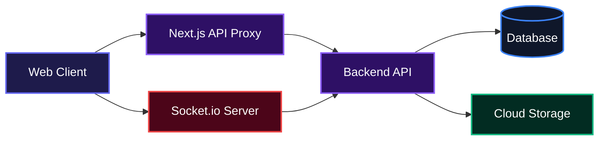
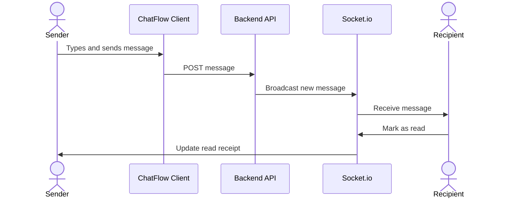
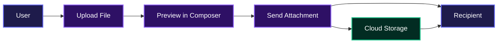
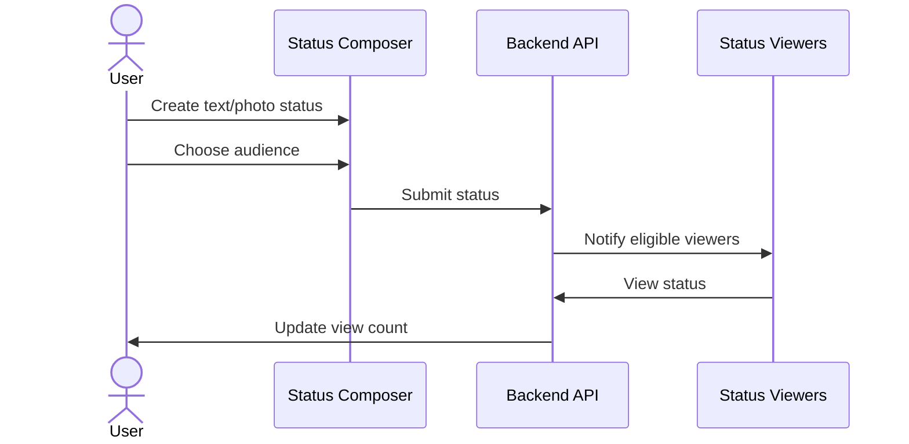
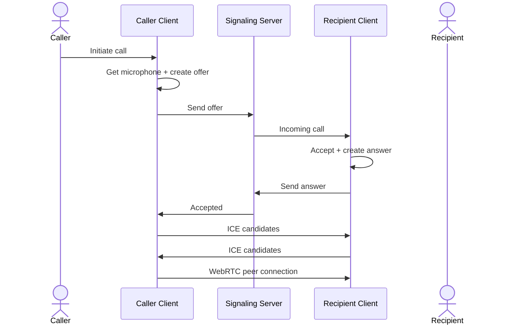

# ChatFlow

A focused, real-time chat application for private conversations, status updates, and secure audio calls.

## Overview

ChatFlow gives developers a complete foundation for a modern messaging experience. It handles everything from account creation and email verification to live message delivery, media sharing, and WebRTC audio calls. Teams can use it to ship a polished, responsive chat app without starting from scratch.

## System Architecture



## Installation

Clone the repository and install dependencies.

```bash
git clone https://github.com/Bensaxxy/chatFlow.git
cd chatFlow
npm install
```

Create a `.env.local` file in the project root.

```bash
NEXT_PUBLIC_API_URL=https://your-backend-api.com
```

Run the development server.

```bash
npm run dev
```

Open `http://localhost:3000` in your browser.

## Usage

After starting the app, you can register a new account or log in. The landing page guides new visitors to sign up, while authenticated users are taken directly to their chat list.

```bash
npm run dev
```

The main features are available at these paths once you are logged in:

- `/chats` — conversation list and search
- `/chats/:conversationId` — active conversation
- `/profile` — account and preference settings
- `/users/:userId` — public profile view

## Features

### Real-Time Messaging

Send and receive messages instantly with typing indicators, read receipts, and delivery status. Messages support text, replies, reactions, edits, and deletion for everyone or just for you.



### Media and File Sharing

Share images, videos, audio notes, documents, and link previews. The media gallery lets you browse shared files by category.



### Status Updates

Post text or photo statuses that disappear after 24 hours. Control who sees each update with audience settings and view replies from friends.



### WebRTC Audio Calls

Make and receive peer-to-peer audio calls directly in the browser. The app negotiates offers and answers through Socket.io, with ICE candidate exchange and optional TURN relay support.



### Other Capabilities

- Secure authentication with email verification and password reset
- Profile management with avatar upload
- Chat themes, wallpapers, and bubble colors
- Push and email notification preferences
- Message search within conversations
- Block and unblock users
- Forward messages to other conversations
- Bulk message selection and deletion

## Technologies Used

| Technology | Purpose |
|------------|---------|
| [Next.js](https://nextjs.org/) | React framework and API routes |
| [React](https://react.dev/) | UI library |
| [TypeScript](https://www.typescriptlang.org/) | Type-safe JavaScript |
| [Tailwind CSS](https://tailwindcss.com/) | Utility-first styling |
| [Socket.io Client](https://socket.io/) | Real-time communication |
| [Axios](https://axios-http.com/) | HTTP client |
| [React Hook Form](https://react-hook-form.com/) | Form management |
| [Zod](https://zod.dev/) | Schema validation |
| [Lucide React](https://lucide.dev/) | Icon library |
| [React Toastify](https://fkhadra.github.io/react-toastify/) | Notifications |

## API Documentation

ChatFlow exposes a single catch-all API proxy at `src/app/api/[...path]/route.ts` that forwards requests to the configured backend. All backend endpoints are accessed through this proxy.

### GET /api/:path
### POST /api/:path
### PUT /api/:path
### PATCH /api/:path
### DELETE /api/:api/:path
### OPTIONS /api/:path
### HEAD /api/:path

**Description**

Proxies any request to the upstream backend API while preserving cookies, request bodies, and selected response headers.

**Request**

Forwarded headers include `accept`, `content-type`, and `cookie`. Request bodies are forwarded for all methods except GET and HEAD.

```json
{
  "any": "payload"
}
```

**Response**

The response from the backend is returned with status, status text, and headers.

```json
{
  "success": true,
  "data": {}
}
```

**Errors**

- 502: The upstream API could not be reached.
- 503: The chat API is not configured.

**Environment Variables**

| Variable | Example | Description |
|----------|---------|-------------|
| `BACKEND_API_URL` | `https://api.chatflow.example.com` | Upstream API base URL |
| `NEXT_PUBLIC_API_URL` | `https://api.chatflow.example.com` | Fallback public API base URL |

## Contributing

Contributions are welcome. If you would like to improve ChatFlow, please open an issue or pull request. Keep code consistent with the existing TypeScript and React patterns.

## License

No LICENSE file is present in this repository.

## Author

Built with care by Oluwasegun Benjamin.

- LinkedIn: [https://linkedin.com/in/oluwasegun-benjamin](https://linkedin.com/in/oluwasegun-benjamin)

## Badges

[](https://www.typescriptlang.org/)
[](https://nextjs.org/)
[](https://react.dev/)
[](https://tailwindcss.com/)
[](https://socket.io/)

[](https://dokugen.samueltuoyo.com)