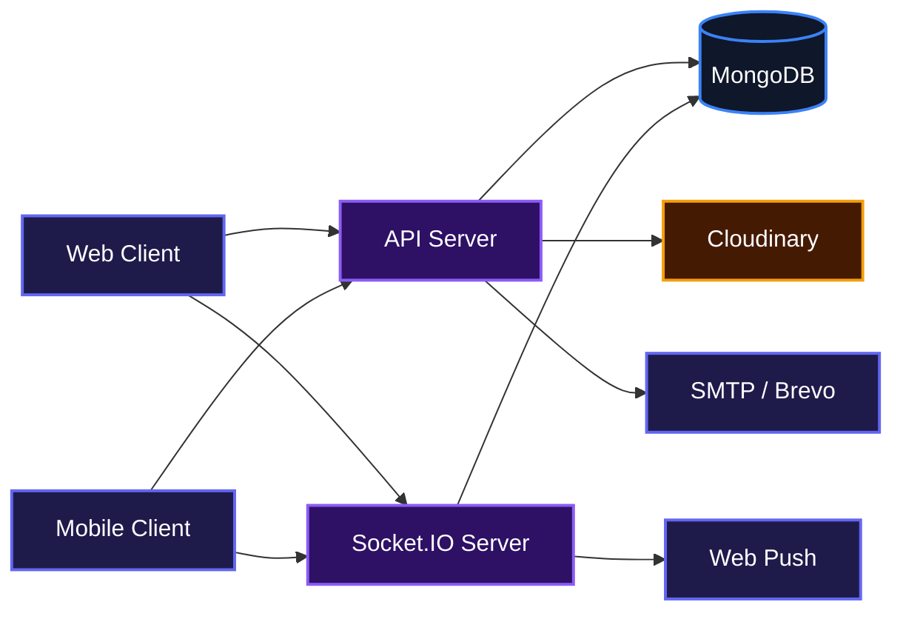
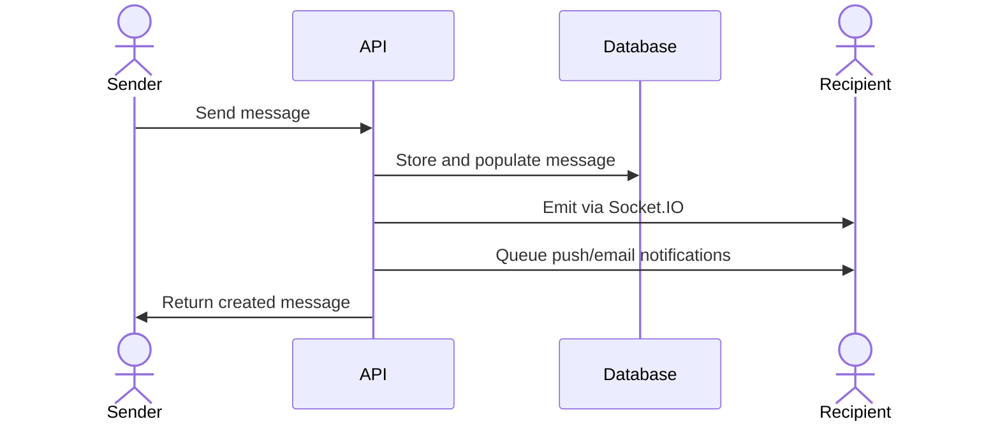
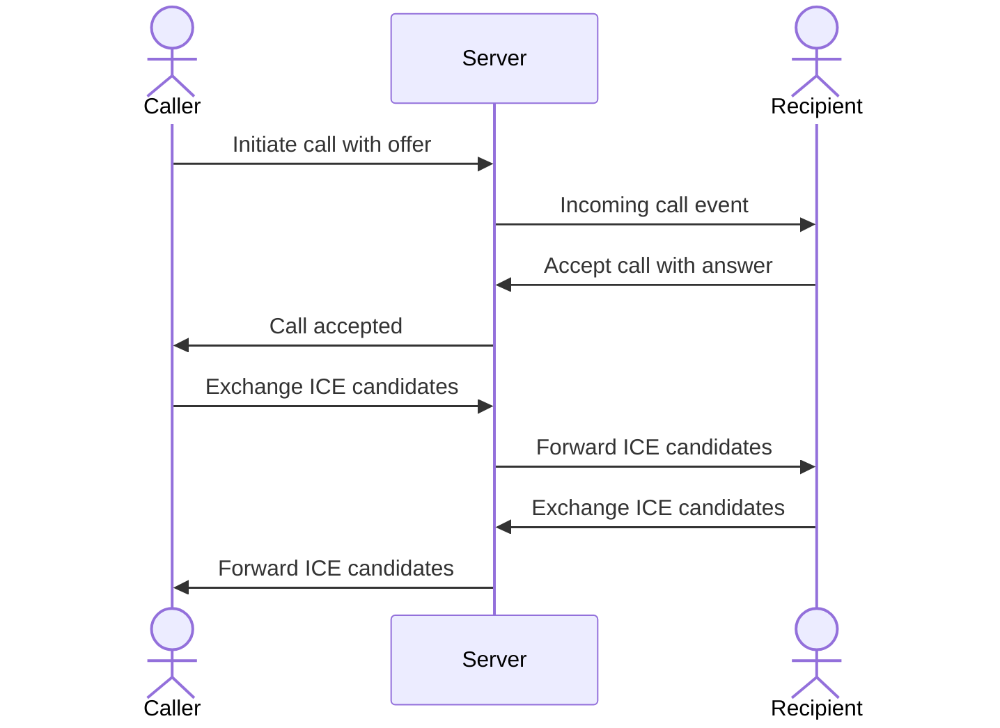

# ChatFlow

ChatFlow is the backend engine for a real-time messaging experience. It gives developers a production-ready API and WebSocket server for building chat applications where users can send messages, share media, make voice calls, and post status updates with secure authentication and privacy controls built in.



## Features

- **Real-time messaging**: Send and receive text, image, file, and audio messages instantly through Socket.IO.
- **Media sharing**: Upload images, videos, voice notes, and documents with Cloudinary-backed storage and automatic MIME validation.
- **WebRTC audio calls**: Initiate and accept peer-to-peer voice calls with signaling, ICE server provisioning, and call history tracking.
- **Status updates**: Post text or photo statuses with audience controls, views, reactions, and automatic cleanup.
- **Authentication**: Register and log in with email verification, JWT sessions, password reset, and dedicated mobile auth flows.
- **Privacy controls**: Manage profile visibility, last seen, read receipts, and block users.
- **Push and email notifications**: Reach offline users with web push notifications and email alerts.

### Real-time messaging flow



### WebRTC audio call flow



## Getting Started

### Prerequisites

- Node.js
- MongoDB instance
- Cloudinary account
- SMTP server or Brevo API key for email delivery
- Optional: VAPID keys for web push notifications

### Installation

Clone the repository:

```bash
git clone https://github.com/Bensaxxy/chatFlow.git
cd chatFlow
```

Install dependencies:

```bash
npm install
```

Set up your environment variables in a `.env` file at the project root.

Start the development server:

```bash
npm run dev
```

The API and Socket.IO server will run at `http://localhost:<PORT>`.

## Usage

Register a new account:

```bash
curl -X POST http://localhost:5000/api/auth/register \
  -H "Content-Type: application/json" \
  -d '{"name":"Jane Doe","email":"jane@example.com","password":"securePassword123"}'
```

Log in:

```bash
curl -X POST http://localhost:5000/api/auth/login \
  -H "Content-Type: application/json" \
  -d '{"email":"jane@example.com","password":"securePassword123"}'
```

Create a direct conversation:

```bash
curl -X POST http://localhost:5000/api/conversations/direct \
  -H "Content-Type: application/json" \
  -H "Cookie: accessToken=<token>" \
  -d '{"participantId":"<userId>"}'
```

Send a message:

```bash
curl -X POST http://localhost:5000/api/conversations/<conversationId>/messages \
  -H "Content-Type: application/json" \
  -H "Cookie: accessToken=<token>" \
  -d '{"content":"Hello from ChatFlow","clientMessageId":"<uuid>"}'
```

## API Documentation

All endpoints return responses in this shape:

```json
{
  "success": true,
  "message": "Operation completed",
  "data": {}
}
```

### Authentication

#### POST /api/auth/register
Create a new account and trigger a verification email.

**Request:**
```json
{
  "name": "Jane Doe",
  "email": "jane@example.com",
  "password": "securePassword123"
}
```

**Response:**
```json
{
  "success": true,
  "message": "Account created successfully. Check your email for the verification code.",
  "data": { "user": { "_id": "...", "name": "Jane Doe", "email": "jane@example.com" } }
}
```

**Errors:**
- 409: An account with this email already exists
- 503: Verification email delivery failed

#### POST /api/auth/verify-email
Verify the email address using the code sent by email.

**Request:**
```json
{
  "email": "jane@example.com",
  "code": "123456"
}
```

**Response:**
```json
{
  "success": true,
  "message": "Email verified successfully. You can now log in."
}
```

#### POST /api/auth/resend-verification
Resend the email verification code.

**Request:**
```json
{
  "email": "jane@example.com"
}
```

**Response:**
```json
{
  "success": true,
  "message": "If an unverified account exists for that email, a new verification code has been sent."
}
```

#### POST /api/auth/login
Authenticate and receive httpOnly access and refresh token cookies.

**Request:**
```json
{
  "email": "jane@example.com",
  "password": "securePassword123"
}
```

**Response:**
```json
{
  "success": true,
  "message": "Login successful",
  "data": { "user": { "_id": "...", "name": "Jane Doe", "email": "jane@example.com" } }
}
```

#### POST /api/auth/forgot-password
Request a password reset link by email.

**Request:**
```json
{
  "email": "jane@example.com"
}
```

**Response:**
```json
{
  "success": true,
  "message": "If an account exists for that email address, a password reset link has been sent."
}
```

#### POST /api/auth/reset-password
Reset the password using the token from the reset email.

**Request:**
```json
{
  "token": "<reset-token>",
  "newPassword": "newSecurePassword123",
  "confirmPassword": "newSecurePassword123"
}
```

**Response:**
```json
{
  "success": true,
  "message": "Password reset successfully. You can now sign in."
}
```

#### POST /api/auth/refresh
Refresh the access token using the httpOnly refresh token cookie.

**Response:**
```json
{
  "success": true,
  "message": "Session refreshed successfully"
}
```

#### POST /api/auth/logout
Clear authentication cookies.

**Response:**
```json
{
  "success": true,
  "message": "Logout successful"
}
```

#### GET /api/auth/me
Get the currently authenticated user.

**Authentication required.**

**Response:**
```json
{
  "success": true,
  "data": { "user": { "_id": "...", "name": "Jane Doe", "email": "jane@example.com" } }
}
```

#### POST /api/auth/socket-token
Generate a short-lived token for Socket.IO authentication.

**Authentication required.**

**Response:**
```json
{
  "success": true,
  "data": { "token": "<socket-token>" }
}
```

#### PATCH /api/auth/change-password
Change the current password.

**Authentication required.**

**Request:**
```json
{
  "currentPassword": "securePassword123",
  "newPassword": "newSecurePassword123",
  "confirmPassword": "newSecurePassword123"
}
```

**Response:**
```json
{
  "success": true,
  "message": "Password changed successfully. Sign in again with your new password."
}
```

#### POST /api/auth/mobile/login
Authenticate a mobile device and receive access and refresh tokens.

**Request:**
```json
{
  "email": "jane@example.com",
  "password": "securePassword123",
  "deviceId": "device-123",
  "deviceName": "iPhone 15"
}
```

**Response:**
```json
{
  "success": true,
  "data": {
    "user": { "_id": "...", "name": "Jane Doe" },
    "accessToken": "<token>",
    "refreshToken": "<token>"
  }
}
```

#### POST /api/auth/mobile/refresh
Refresh a mobile session.

**Request:**
```json
{
  "refreshToken": "<refresh-token>"
}
```

**Response:**
```json
{
  "success": true,
  "data": {
    "user": { "_id": "...", "name": "Jane Doe" },
    "accessToken": "<token>",
    "refreshToken": "<token>"
  }
}
```

#### POST /api/auth/mobile/logout
Revoke a mobile session.

**Request:**
```json
{
  "refreshToken": "<refresh-token>"
}
```

**Response:**
```json
{
  "success": true,
  "message": "Mobile logout successful"
}
```

### Users

#### GET /api/users/search
Search users by name or email.

**Authentication required.**

**Query:** `?q=jane&limit=10`

**Response:**
```json
{
  "success": true,
  "data": { "users": [{ "_id": "...", "name": "Jane Doe", "email": "jane@example.com" }] }
}
```

#### GET /api/users/me
Get the authenticated user's full profile.

**Authentication required.**

#### PATCH /api/users/me
Update the authenticated user's profile.

**Authentication required.**

**Request:**
```json
{
  "name": "Jane Smith",
  "bio": "Building things with code."
}
```

#### PATCH /api/users/me/chat-theme
Update chat theme preferences.

**Authentication required.**

**Request:**
```json
{
  "appearance": "dark",
  "wallpaper": "aurora",
  "bubbleColor": "violet"
}
```

#### PATCH /api/users/me/privacy
Update privacy settings.

**Authentication required.**

**Request:**
```json
{
  "profilePhotoVisibility": "everyone",
  "lastSeenVisibility": "nobody",
  "readReceipts": true
}
```

#### PATCH /api/users/me/notifications
Update notification settings.

**Authentication required.**

**Request:**
```json
{
  "emailNotifications": true,
  "messageSound": "chime",
  "vibration": true
}
```

#### PATCH /api/users/me/avatar
Upload a profile picture. Accepts `multipart/form-data` with an `avatar` field.

**Authentication required.**

#### DELETE /api/users/me/avatar
Remove the current profile picture.

**Authentication required.**

#### GET /api/users/:userId/profile
Get a user's public profile.

**Authentication required.**

#### PUT /api/users/:userId/block
Block a user.

**Authentication required.**

#### DELETE /api/users/:userId/block
Unblock a user.

**Authentication required.**

### Conversations

#### GET /api/conversations/
List all conversations for the authenticated user.

**Authentication required.**

**Response:**
```json
{
  "success": true,
  "data": {
    "conversations": [
      {
        "_id": "...",
        "type": "direct",
        "participants": [],
        "unreadCount": 2,
        "isPinned": false
      }
    ]
  }
}
```

#### POST /api/conversations/direct
Create or retrieve a direct conversation with another user.

**Authentication required.**

**Request:**
```json
{
  "participantId": "<user-id>"
}
```

#### GET /api/conversations/:conversationId
Get a single conversation by ID.

**Authentication required.**

#### PATCH /api/conversations/:conversationId/pin
Pin or unpin a conversation.

**Authentication required.**

**Request:**
```json
{
  "isPinned": true
}
```

#### PATCH /api/conversations/:conversationId/unread
Mark a conversation as unread.

**Authentication required.**

#### POST /api/conversations/:conversationId/clear
Clear the conversation history for the current user.

**Authentication required.**

#### PATCH /api/conversations/:conversationId/read
Mark all messages in a conversation as read.

**Authentication required.**

#### GET /api/conversations/:conversationId/messages
List messages in a conversation.

**Authentication required.**

**Query:** `?limit=30&cursor=<message-id>&q=<search>`

**Response:**
```json
{
  "success": true,
  "data": {
    "messages": [],
    "nextCursor": "<message-id>",
    "hasMore": true
  }
}
```

#### GET /api/conversations/:conversationId/media
List media in a conversation by category.

**Authentication required.**

**Query:** `?category=images&limit=36&cursor=<message-id>`

#### GET /api/conversations/:conversationId/messages/:messageId/context
Get the context around a specific message.

**Authentication required.**

#### POST /api/conversations/:conversationId/messages
Send a text message.

**Authentication required.**

**Request:**
```json
{
  "content": "Hello from ChatFlow",
  "replyToMessageId": null,
  "clientMessageId": "<uuid>"
}
```

#### POST /api/conversations/:conversationId/messages/attachment
Send a message with a file attachment. Accepts `multipart/form-data` with an `attachment` field.

**Authentication required.**

#### POST /api/conversations/:conversationId/messages/:messageId/forward
Forward a message to other conversations.

**Authentication required.**

**Request:**
```json
{
  "targetConversationIds": ["<conversation-id-1>", "<conversation-id-2>"]
}
```

#### PATCH /api/conversations/:conversationId/messages/:messageId
Edit a message.

**Authentication required.**

**Request:**
```json
{
  "content": "Updated message content"
}
```

#### PATCH /api/conversations/:conversationId/messages/:messageId/reaction
Add or remove a reaction on a message.

**Authentication required.**

**Request:**
```json
{
  "emoji": "👍"
}
```

#### DELETE /api/conversations/:conversationId/messages/:messageId
Delete a message for the current user or everyone.

**Authentication required.**

**Request:**
```json
{
  "scope": "me"
}
```

### Calls

#### GET /api/calls/ice-servers
Get ICE server configuration for WebRTC calls.

**Authentication required.**

**Response:**
```json
{
  "success": true,
  "data": {
    "iceServers": [{ "urls": "stun:stun.l.google.com:19302" }],
    "hasTurnServer": false
  }
}
```

#### GET /api/calls/history
Get call history for a conversation.

**Authentication required.**

**Query:** `?conversationId=<conversation-id>`

### Push Notifications

#### GET /api/push/config
Get the VAPID public key for push subscriptions.

**Response:**
```json
{
  "success": true,
  "data": {
    "enabled": true,
    "publicKey": "<vapid-public-key>"
  }
}
```

#### POST /api/push/subscriptions
Subscribe to push notifications.

**Authentication required.**

**Request:**
```json
{
  "endpoint": "https://fcm.googleapis.com/fcm/send/...",
  "expirationTime": null,
  "keys": {
    "p256dh": "...",
    "auth": "..."
  }
}
```

#### DELETE /api/push/subscriptions
Unsubscribe from push notifications.

**Authentication required.**

**Request:**
```json
{
  "endpoint": "https://fcm.googleapis.com/fcm/send/..."
}
```

### Statuses

#### GET /api/statuses
List status updates visible to the authenticated user.

**Authentication required.**

#### POST /api/statuses/text
Create a text status update.

**Authentication required.**

**Request:**
```json
{
  "text": "Hello world",
  "backgroundColor": "cyan",
  "textColor": "light",
  "audience": "people_i_chat_with",
  "selectedUserIds": [],
  "excludedUserIds": []
}
```

#### POST /api/statuses/photo
Create a photo status update. Accepts `multipart/form-data` with a `photo` field.

**Authentication required.**

#### GET /api/statuses/:statusId/viewers
List users who viewed a status.

**Authentication required.**

#### POST /api/statuses/:statusId/view
Mark a status as viewed.

**Authentication required.**

#### PATCH /api/statuses/:statusId/reaction
Add or remove a reaction on a status.

**Authentication required.**

#### GET /api/statuses/:statusId
Get a single status.

**Authentication required.**

#### DELETE /api/statuses/:statusId
Delete a status.

**Authentication required.**

## Environment Variables

| Variable | Description | Example |
|---|---|---|
| `PORT` | Port the server listens on | `5000` |
| `NODE_ENV` | Application environment | `development` |
| `MONGODB_URI` | MongoDB connection string | `mongodb://localhost:27017/chatflow` |
| `JWT_ACCESS_SECRET` | Secret for access token signing | `your-access-secret` |
| `JWT_REFRESH_SECRET` | Secret for refresh token signing | `your-refresh-secret` |
| `ACCESS_TOKEN_TTL_SECONDS` | Access token lifetime in seconds | `900` |
| `REFRESH_TOKEN_TTL_SECONDS` | Refresh token lifetime in seconds | `604800` |
| `EMAIL_VERIFICATION_SECRET` | Secret for verification code HMAC | `your-verification-secret` |
| `CLIENT_URL` | URL of the frontend client | `https://chatflow.example.com` |
| `SMTP_HOST` | SMTP server host | `smtp.example.com` |
| `SMTP_PORT` | SMTP server port | `587` |
| `SMTP_SECURE` | Use TLS for SMTP | `false` |
| `SMTP_USER` | SMTP username | `user@example.com` |
| `SMTP_PASSWORD` | SMTP password | `your-smtp-password` |
| `EMAIL_FROM` | Sender address for emails | `"ChatFlow" <noreply@example.com>` |
| `BREVO_API_KEY` | Optional Brevo API key for email delivery | `your-brevo-key` |
| `CLOUDINARY_CLOUD_NAME` | Cloudinary cloud name | `your-cloud-name` |
| `CLOUDINARY_API_KEY` | Cloudinary API key | `your-api-key` |
| `CLOUDINARY_API_SECRET` | Cloudinary API secret | `your-api-secret` |
| `VAPID_SUBJECT` | VAPID subject URL for web push | `mailto:admin@example.com` |
| `VAPID_PUBLIC_KEY` | VAPID public key | `your-public-key` |
| `VAPID_PRIVATE_KEY` | VAPID private key | `your-private-key` |
| `WEBRTC_ICE_SERVERS` | JSON array of ICE servers | `[{"urls":"stun:stun.l.google.com:19302"}]` |
| `WEBRTC_TURN_URLS` | Comma-separated TURN server URLs | `turn:turn.example.com:3478` |
| `WEBRTC_TURN_USERNAME` | TURN server username | `turn-user` |
| `WEBRTC_TURN_CREDENTIAL` | TURN server credential | `turn-pass` |

## Technologies Used

| Technology | Description |
|---|---|
| [TypeScript](https://www.typescriptlang.org/) | Typed JavaScript for safer backend code |
| [Node.js](https://nodejs.org/) | JavaScript runtime |
| [Express](https://expressjs.com/) | Web framework |
| [MongoDB](https://www.mongodb.com/) | Document database |
| [Mongoose](https://mongoosejs.com/) | MongoDB object modeling |
| [Socket.IO](https://socket.io/) | Real-time bidirectional communication |
| [Cloudinary](https://cloudinary.com/) | Media upload and storage |
| [Nodemailer](https://nodemailer.com/) | SMTP email delivery |
| [web-push](https://github.com/web-push-libs/web-push) | Web push notifications |
| [Zod](https://zod.dev/) | Schema validation |
| [bcryptjs](https://github.com/dcodeIO/bcrypt.js) | Password hashing |
| [Helmet](https://helmetjs.github.io/) | HTTP security headers |
| [CORS](https://github.com/expressjs/cors) | Cross-origin resource sharing |

## Contributing

Contributions are welcome. Feel free to open issues or pull requests. Please keep changes focused and include clear descriptions so they are easy to review.

## Author

- LinkedIn: [oluwasegun-benjamin](https://linkedin.com/in/oluwasegun-benjamin)
- GitHub: [Bensaxxy](https://github.com/Bensaxxy)

## Badges

[](https://www.typescriptlang.org/)
[](https://nodejs.org/)
[](https://expressjs.com/)
[](https://www.mongodb.com/)
[](https://socket.io/)
[](https://cloudinary.com/)

[](https://dokugen.samueltuoyo.com)